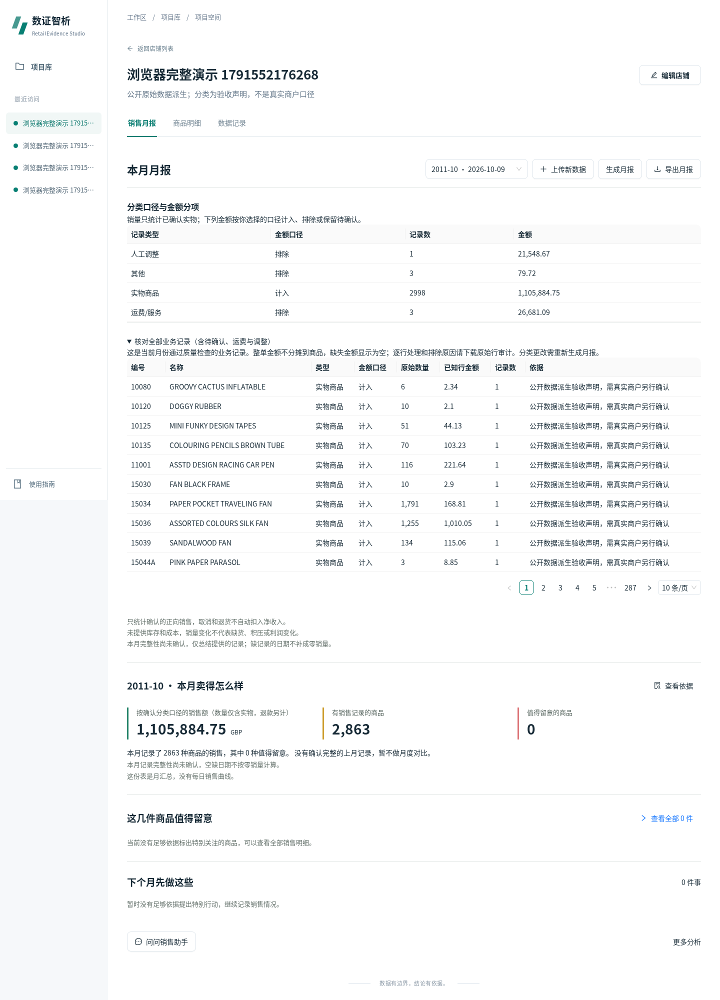

# RetailEvidence Studio

小商户月度销售与备货助手，沿用团队 FastAPI、SQLite/SQLAlchemy、React/TypeScript 架构。版本 0.6.0，schema 5，销售算法 sales-v2.2.0；当前验收状态以 [实际报告](docs/ACCEPTANCE_REPORT.md) 为准。

上传收银明细、独立商品日汇总或月汇总 → 确认字段、月份、记录类型与金额口径 → 检查数据 → 生成月报 → 查看全部商品及异常原始记录 → 保存核对备注 → CPU AI 解释证据 → 导出 HTML/CSV/JSON、浏览器打印 PDF。RF/RFM 客户分群与 FP-growth 共购保留在“更多分析”。

分类支持实物、运费/服务、人工调整、其他、待确认。规则按数据版本与字段版本冻结，来源行规则优先，其次商品编号、已映射分类、默认口径；类型与金额是否计入分别确认。待确认项能核对明细，关键类型未知时暂停不可靠预测与建议。不会按名称包含 POST 等字符串全局删行。旧报告保留原口径，修改分类产生新运行。

AI 只解释冻结证据，数字由程序填写。没有库存不能算进货量，没有成本不算利润；七天销量参考不等于整月采购量。公开批发数据验收不代表小店真实经营收益。

## 运行（Ubuntu，Python 3.12、Node 24）

以下流程在独立环境实测；需要已安装 uv（不在本任务中全局安装）。先进入自己的源码目录，将所有状态、缓存与临时文件放在该目录或独立运行目录。

```bash
export TMPDIR="$PWD/.runtime/tmp"
export XDG_CACHE_HOME="$PWD/.runtime/cache"
export UV_CACHE_DIR="$PWD/.runtime/cache/uv"
export npm_config_cache="$PWD/.runtime/cache/npm"
export PYTHONDONTWRITEBYTECODE=1
export MPLCONFIGDIR="$PWD/.runtime/cache/matplotlib"
mkdir -p "$TMPDIR" "$UV_CACHE_DIR" "$npm_config_cache" "$MPLCONFIGDIR"
uv venv --python /usr/bin/python3 .venv
uv pip install --python .venv/bin/python -r requirements-dev.txt
cd frontend
npm ci --no-audit --no-fund --ignore-scripts
npm run build -- --configLoader runner
cd ..
export AIC_STATE_DIR="$PWD/.runtime/state"
export AIC_STORAGE_DIR="$PWD/.runtime/storage"
export AIC_STATIC_DIR="$PWD/frontend/dist"
export AIC_PUBLIC_DATA_DIR="$PWD/.runtime/public"
export AIC_SOURCE_COMMIT="$(git rev-parse HEAD)"
export AIC_AI_URL=http://127.0.0.1:8081/v1/chat/completions
bash scripts/run.sh
```

默认 Web `http://127.0.0.1:8000`，单 Worker；首次在自己的状态目录初始化 schema 5。环境通过进程变量提供，脚本不会自动加载 `.env`；安全样例见 [.env.example](.env.example)。`.runtime/` 不提交 Git。Ubuntu 未安装 ensurepip 时可使用已有 uv，无须 sudo。Windows 操作需遵守 [C 盘保护与交接](docs/HANDOFF.md)，本任务主要测试在远端完成。

模型使用 [官方 Qwen2.5-1.5B GGUF](https://huggingface.co/Qwen/Qwen2.5-1.5B-Instruct-GGUF) 和 llama.cpp CPU 服务，详细配置、SHA-256、线程与端口见 [技术交接](docs/HANDOFF.md)。模型不可用仍可使用确定性报告，界面明确标记回退。没有模型权重、原始大数据、个人凭据或数据库随 Git 发布。

## 测试与证据

```bash
export PYTHONPATH="$PWD/backend"
export OMP_NUM_THREADS=2 OPENBLAS_NUM_THREADS=2 MKL_NUM_THREADS=2 NUMEXPR_NUM_THREADS=2
.venv/bin/python -B -m pytest -p no:cacheprovider scripts/test_record_classification.py scripts/test_task_safety.py scripts/test_ai_contract.py -q
.venv/bin/ruff check --no-cache backend scripts/test_record_classification.py scripts/test_task_safety.py scripts/test_ai_contract.py scripts/accept_classified_public.py
```

38 个唯一测试在干净环境通过，后续增加2项边界已单独通过；最终全套复验见报告，另有真实原始 XLSX、日/月派生、CPU AI、旧分析及桌面/390px 浏览器执行记录。最终提交的复验状态见 [验收报告](docs/ACCEPTANCE_REPORT.md)、[矩阵](docs/FEATURE_ACCEPTANCE_MATRIX.md)、[机器可读矩阵](docs/acceptance_matrix.csv)。截图与运行证据只表示标注的实际提交，不替代最终复验。

预测实测选择四周平均：独立测试 MAE 63.6291、WAPE 65.3999%；复杂模型未超过简单基线。测试商品 1000/eligible 1321，发布382；异常2106/93341，只是无标签报警，没有检测准确率。

## 目录与贡献

`backend/app/`：输入、质量、持久任务、销售与旧算法；`frontend/src/`：现有页面及业务分类确认；`scripts/`：启动、测试、独立验收；`docs/`：需求追踪、证据、演示和交接；`examples/`：可公开小样例（不是冻结真实评测集）。

原团队仓库历史及 chang-zihe 的作者署名完整保留；原服务器 0.5.0 增量导入有专门基线提交。LSTongXXN 创建个人私有仓库并承担本轮分类修复与交付整合，不声称团队全部代码个人原创。许可和依赖见 [THIRD_PARTY](docs/THIRD_PARTY.md)；团队自研代码未擅自改为开源许可，公开发布需另行确认。

[演示指南](docs/DEMO_GUIDE.md) · [变更](CHANGELOG.md) · [基线](docs/BASELINE_AUDIT.md) · [限制](docs/KNOWN_LIMITATIONS.md)



截图来自9fe8c11的真实浏览器月汇总上传流程，待确认/费用展示与数字对应上述run，不是设计Mock。
