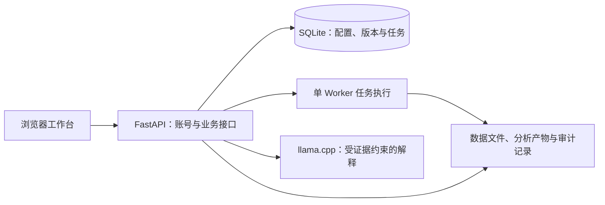

# 数证智析 · RetailEvidence Studio

**面向小商户的销售分析与经营复盘工作台。**

把 CSV / Excel 营业表转成可核对的销售月报，查看商品表现、客户购买特征和商品搭配线索，并在数据条件满足时提供未来七天销量参考。每个重要结论都尽量连接到计算依据、数据版本或原始记录，帮助使用者判断“卖得怎么样、哪些地方值得核查、接下来可以尝试什么”。

系统采用 **确定性程序计算 + 受证据约束的 AI 解释**：金额、数量和算法结果由程序生成，AI 辅助组织说明，不替用户确认业务口径，也不编造库存、利润或异常原因。

> 当前 `main` 已整合团队正式代码及后续日期、上传修复。销售算法为 `sales-v3.1.1`，共购算法为 `association-v2`，助手协议为 `sales-explain-v4`，数据库为 **schema 6**。应用包仍沿用 `0.5.0` 标记；识别交付版本请以 Git 提交为准，不要只比较包版本号。同步基线与历史来源见 [正式源码同步记录](docs/FORMAL_MAIN_SYNC_20261025.md)。

## 主要功能

| 模块 | 可以完成什么 |
| --- | --- |
| 账号与店铺 | 自行注册、登录、修改密码、退出；按账号隔离店铺及其数据、分析和导出；创建、编辑、搜索、切换店铺 |
| 数据导入 | 上传 CSV / XLSX，选择编码、分隔符或工作表，预览原始数据，保存和继续导入草稿；也可选择部署环境已准备的公开数据 |
| 字段与口径 | 确认商品、客户、订单、日期、数量和金额字段；区分交易明细、商品日汇总与月汇总；确认币种、数量单位、退货和取消含义 |
| 质量与追溯 | 检查缺失、重复候选、订单冲突和适用能力；保留来源哈希、来源行、映射版本、排除原因与运行记录 |
| 销售总览 | 按月查看销售额、销量、商品结构与满足条件的月度比较；展示重点商品及最多三项有依据的行动建议 |
| 商品分析 | 搜索、筛选和排序商品；查看贡献、变化、日走势、异常日期及来源记录；保存核查备注和处理状态 |
| 记录分类 | 区分实物商品、费用或服务、记账项目与待确认项；更改类型后生成新月报，保留旧运行；费用和记账项不参与实物备货 |
| 预测与备货 | 满足历史和验证条件后提供七天累计销量参考、历史误差和不可用原因；结合用户确认的库存、到货、备用量与包装单位计算备货参考 |
| 商品搭配 | FP-growth 共购分析，展示共同出现次数、支持度、置信度、提升度及验证信息，保留历史分析结果 |
| 客户分析 | RF / RFM 特征与客户分群，查看购买习惯、群体特征和质量诊断；有适用证据时提供客户关注线索 |
| 销售助手 | 基于当前月报或商品证据问答，提供示例问题、澄清和数据限制说明；区分真实模型解释与回退结果 |
| 历史与导出 | 选择历史月报，保留带 `run` 参数的访问上下文；导出 HTML、CSV、JSON 和清单，HTML 可用浏览器打印为 PDF |
| 操作指导与任务 | 在复杂字段旁按需展开帮助；查看持久任务的排队、进度、失败和取消状态，避免重复提交同一任务 |

当前店铺导航包括 **销售总览、商品分析、搭配建议、数据记录、更多分析**。月报生成后，系统会按数据条件安排后续共购与客户分析；不适用、无结果和执行失败分别呈现。“更多分析”保留独立质量检查、RF/RFM 和共购入口。

首页行动是经过筛选的摘要，同一种行动策略不会重复占满列表。例如只展示一组搭配建议，不代表完整共购分析只有一条规则。

## 一次完整的使用流程

1. **注册并创建店铺。** 登录后进入项目库，为一家店铺或一套独立业务建立工作区。用户名使用 3–32 位字母、数字、下划线或短横线，首位为字母或数字；密码长度为 12–128 位。
2. **上传营业表并检查预览。** 确认表头、编码、工作表和“一行代表什么”。上传成功只表示文件已读取，还需要确认字段和业务含义。
3. **核对字段与统计口径。** 商品编号、日期、数量等对应真实列；行金额与订单总额不要混用。同一订单重复出现的整单金额不能按每行累计。不知道含义的字段保留未确认，不靠猜测填满。
4. **选择月份与记录范围。** 月汇总需指定所属月份；日级数据需核对实际覆盖起止日、缺失日和停业日。只有确认完整的日期范围，才能将没有成交的日期作为零销量处理。多文件分析需要明确选择来源及追加、替换和重叠处理方式。
5. **检查数据，再生成月报。** 核对记录类型、取消/退货、重复候选和排除原因。修改映射、分类或分析口径会产生新的配置或运行，不把旧报告直接改写成新口径。
6. **从概况进入依据。** 在销售总览看重点；在商品分析查看完整列表、异常日和原始行；在搭配建议及更多分析查看适用的订单与客户分析。按需保存核查备注。
7. **按条件使用备货和 AI。** 有可发布预测时，再填写与预测起点一致的库存快照。可向助手提问“本月哪些商品值得留意？”或“这件商品为什么不能预测？”，并核对回答中的证据及生成状态。
8. **导出并复盘。** 下载 HTML 报告或完整 CSV / JSON。需要 PDF 时，打开导出的 HTML，使用浏览器“打印 → 另存为 PDF”，检查中文、分页和附页。

### 什么数据能支持哪些分析

| 数据条件 | 可用范围与限制 |
| --- | --- |
| 商品月汇总 | 月度销量、结构及满足口径条件的比较；不能还原每日走势、异常日期或七天预测 |
| 商品日汇总 | 日走势；记录覆盖、成交历史和验证结果满足要求后，才可能提供异常与预测 |
| 逐行交易明细 | 商品、日期、数量支持销售分析；金额可信时增加金额分析；可靠订单和客户字段再扩展共购及客户分析 |
| 可靠的订单边界及商品记录 | 支持共购；缺少客户或金额不一定阻止共购，但不完整购物篮需按质量规则处理 |
| 可靠客户、订单与购买时间 | 满足样本条件后可做 RF；金额有效时可做 RFM。缺少客户标识不能凭空生成客户群 |
| 只有购物篮商品列表 | 适用于共购；不能补造销售时间、销量、客户或收入来生成完整经营月报 |

不同币种、数量单位和统计口径不能未经确认混合比较。历史数据只能支持相应历史期间的分析；不要把今天的库存填入几个月前的预测。

## 分析方法与结果边界

| 能力 | 当前实现 | 正确理解方式 |
| --- | --- | --- |
| 商品表现 | 销售贡献、ABC 分层、稳定性和变化拆解 | 描述销售记录中的表现；销售额不是利润，变化拆解不是因果证明 |
| 七天销量参考 | 梯度提升回归与上周销量、四周平均、SES、Croston-SBA 等候选比较；采用时间顺序验证与发布门槛 | 复杂模型不一定更好；不满足条件时拒绝发布或使用可接受的简单方法 |
| 异常核查 | 同星期历史参考、中位数/MAD、Isolation Forest 等检测及事件合并 | 异常是需要核查的线索，不等于已确认缺货、促销或经营故障；没有真实原因标签就不宣称识别准确率 |
| 客户分群 | RF/RFM、`log1p`、RobustScaler、KMeans 与质量诊断 | R 为距最近购买的时间，F 为购买频次，M 为购买金额；分群是复盘辅助，不是客户价值或未来收益保证 |
| 商品共购 | FP-growth、支持度/置信度/提升度及留出验证、热门基线比较 | 经常一起购买不代表因果；也不保证陈列调整能提高销售额 |
| 备货参考 | `max(0, 七天预测量 + 备用量 − 可售库存 − 期内确定到货量)`，再按包装单位向上取整 | 必须确认实物属性、库存日期和到货条件；备用量由用户决定，结果不保证不会缺货 |
| AI 解释 | Qwen2.5-1.5B-Instruct GGUF + llama.cpp CPU 推理，服务端绑定已计算事实 | AI 不计算业务数字，不直接修改数据，不执行任意 SQL/Python；服务不可用、超时或输出不合规时回退并说明状态 |

核心预测和异常模块见 [sales_mining_v3.py](backend/app/sales_mining_v3.py)，共购见 [association.py](backend/app/association.py)，客户分群见 [clustering.py](backend/app/clustering.py)。更详细的方法与历史评测见 [数据分析算法与功能说明](docs/数据分析算法与功能说明.md)；历史文档中的 schema、导航和协议版本需按其记录日期解读，当前值以上方版本说明及源码为准。

## 技术结构

前端使用 React、TypeScript、Ant Design 和 Vite；后端使用 FastAPI、SQLAlchemy、SQLite；数据处理使用 pandas、NumPy、PyArrow、scikit-learn 和 mlxtend。模型是独立的本地 CPU 服务，不是上传和月报计算的必要前提。



```text
backend/app/       API、账号与归属校验、导入、质量、销售及挖掘算法
frontend/src/      页面、业务组件、操作帮助、日期校验与样式
frontend/public/   静态品牌资源
scripts/           启动、公开数据准备、评测与回归脚本
docs/              数据/API 合同、算法说明、接手记录与源码清单
requirements*.txt  Python 依赖及固定版本
frontend/package-lock.json  前端依赖锁文件
storage/           运行时创建：数据库、上传、版本资产与结果（不入库）
```

## 部署与启动

### 运行环境

已验证的运行平台是 **Ubuntu 24.04、Python 3.12、Node.js 24**。Windows 可通过 SSH 管理 Linux 服务并使用浏览器访问；本项目尚未将原生 Windows 后端执行列为已验证部署方式。

重任务使用单 Worker 串行执行，并限制线程、时间和内存；不要通过增加 Web workers 绕过任务锁。当前导入限制包括单文件 100 MiB、150 万展开行、200 列，XLSX 解压内容上限 1 GiB。重任务开始前检查可用磁盘，低于 20 GiB 时可能拒绝处理。部署时还需为依赖、模型、原始数据和运行产物留出空间。

### 新环境快速启动

以下为 **Linux 新检出、独立数据目录** 的部署步骤。仓库当前为私有，克隆需要你自己的读取权限。现有团队正式环境不要直接照此重新初始化。

```bash
git clone git@github.com:LSTongXXN/RetailEvidence-Studio.git
cd RetailEvidence-Studio
git switch main

# Python 3.12 及其 venv 支持需预先可用
python3.12 -m venv .venv
.venv/bin/python -m pip install -r requirements.txt

cd frontend
npm ci
npm run build
cd ..

bash scripts/run.sh
```

启动后访问 [http://127.0.0.1:8000](http://127.0.0.1:8000)，注册自己的账号。首次启动会创建 SQLite 状态与表结构；已有数据库会经过兼容性检查和增量建表，**升级前应先做一致性备份**。前台运行时使用 `Ctrl+C` 停止该实例。

本次交付已在现有依赖环境验证类型检查、构建及隔离接口；上述“全新机器联网安装全部依赖”未在 README 整理轮重新执行，首次安装仍需验证网络、包源和平台兼容性。

### 环境变量

启动脚本读取进程环境，**不会自动加载 `.env` 文件**。相对业务路径按项目根目录解析；部署差异应通过环境变量配置。

| 变量 | 默认值 / 用途 |
| --- | --- |
| `AIC_PY` | `.venv/bin/python`，Web 使用的 Python 解释器 |
| `AIC_PORT` | `8000`，Web 回环监听端口 |
| `AIC_STATE_DIR` | `storage/state`，SQLite 状态目录 |
| `AIC_STORAGE_DIR` | `storage`，上传、数据版本、分析产物根目录 |
| `AIC_PUBLIC_DATA_DIR` | `storage/datasets/public`，已准备的公开数据目录 |
| `AIC_STATIC_DIR` | `frontend/dist`，前端构建目录 |
| `AIC_AI_URL` | `http://127.0.0.1:8081/v1/chat/completions`，模型接口 |
| `AIC_COOKIE_SECURE` | `0`；通过 HTTPS 部署时设为 `1` |

启动第二个测试实例时，必须同时隔离端口、状态目录和资产目录，不能只换端口而共用正式数据库。前端开发服务器可用 `npm run dev`，默认 `127.0.0.1:5173`，将 `/api` 代理到本机 `8000`；正式运行使用构建后的同源页面。

### 远程服务器访问

Web 默认只监听回环地址。使用已有可信 SSH 连接，将服务器的 Web 端口转到本机，例如：

```bash
# SERVER_ALIAS 是你已配置并核验主机身份的服务器别名
ssh -N -o StrictHostKeyChecking=yes -L 18080:127.0.0.1:8000 SERVER_ALIAS
```

保持隧道进程运行，在同一台电脑打开 [http://127.0.0.1:18080](http://127.0.0.1:18080)。这不是可分享给外部评委的公网链接；服务器关机、Web 未启动或隧道断开时都会无法访问。公网部署需另行配置 HTTPS、访问控制和运行维护，仓库同步不等于网站已上线。

### CPU AI 服务（可选）

现有 `scripts/run_ai.sh` 面向团队服务器，依赖预先配置的共享环境与模型路径，**不是任意机器开箱即用的通用安装脚本**。新环境需自行准备与部署记录匹配的 llama.cpp 和 Qwen2.5-1.5B-Instruct GGUF 权重，并核对来源、量化版本、许可及哈希。仓库不包含权重，也不会自动下载。

以下参数对应现有启动配置，路径需替换为本机实际值；新机器上的模型准备与启动需单独验收：

```bash
LLAMA_BIN=/path/to/llama-server
MODEL_GGUF=/path/to/qwen2.5-1.5b-instruct-q4_k_m.gguf
"$LLAMA_BIN" -m "$MODEL_GGUF" \
  -ngl 0 -t 2 -tb 2 -np 1 -c 4096 \
  --host 127.0.0.1 --port 8081 --alias aic-assistant
```

使用 CPU、两线程、单推理槽与 4096 上下文。未启动模型时，基础上传和分析仍可使用；助手的确定性回退不能被当作真实模型推理成功。

## 数据、账号与维护

- **账号边界：** 账号、会话与项目归属由后端校验，项目和导出接口均受保护；会话使用 HttpOnly、SameSite Cookie，默认 12 小时有效，修改密码会撤销其他会话。当前未提供邮件找回密码流程。
- **旧项目归属：** 未归属的历史项目不会自动分给第一个注册用户。维护者应核实接收账号和项目，再使用 [account_admin.py](backend/app/account_admin.py)；默认只检查，只有明确添加 `--apply` 才写入，并先做在线备份。密码恢复通过终端隐藏输入，不在文档中记录密码。
- **历史一致性：** 保存来源哈希、映射/策略、运行 ID 和审计记录。备注及后续兼容分析的建议有独立更新机制，不应把它们与冻结的原始输入、月度统计口径混为一谈。
- **备份恢复：** 活动 SQLite 使用在线 backup API 或经审查的备份方案；同时保存所引用的数据版本和分析资产。只复制活动 `.sqlite3` 主文件不构成可靠完整备份。先在独立目录验证恢复，再考虑替换正式环境。
- **兼容性：** 当前 schema 6 包含账号相关表，不要把它直接交给旧版程序。回退时同时评估代码与数据库兼容性，保留升级后新增数据。
- **源码边界：** 数据库、真实商户数据、模型、依赖目录、备份及凭据不进入仓库；不要把运行目录整包提交到 Git。

公开数据的来源与许可记录见 [公开数据说明](docs/public-data.md) 和 [清单](docs/public-data-manifests.json)。`scripts/prepare_public_data.py`、`scripts/profile_public_data.py` 用于下载/派生与统计，另需 `requirements-data.txt` 中的依赖；运行前检查输出目录、网络及磁盘。公开批发数据和合成演示数据不能当作真实小商户试用或经营收益证明。

## 验证状态与复现入口

以下是 **2026-10-25 正式同步基线 `bfc72fe`** 的实际验证记录，不代表每次检出都自动完成了全站验收，也不是“系统没有任何 bug”的承诺。本次 README 整理只改变说明文档。

| 检查 | 结果 |
| --- | --- |
| 正式源码清单对照 | 164 个文件 SHA-256 一致；README 后续文档修改不改变该历史快照 |
| 前端类型检查及生产构建 | PASS；重新构建的 12 个文件与正式同名静态资源一致 |
| 日期与覆盖范围边界 | PASS，26 项 |
| 历史报告选择、销售信号展示 | PASS；销售信号包含 6 个场景 |
| 隔离账号接口冒烟 | PASS，13 项，包括注册、登录、跨账号隔离与会话失效 |
| 原样后端 unittest 全量发现 | **FAIL：134 次执行，84 通过、50 ERROR**；旧测试在未完成现有鉴权准备时读取项目 ID，需要维护测试夹具 |
| 同步轮完整浏览器流程、真实 CPU AI 重跑 | NOT_RUN；此前历史验收不能代替本轮执行 |
| 真实商户使用与经营收益 | 未验证 |

在已经准备好依赖的独立检出目录，可执行以下前端检查（Node.js 24）：

```bash
(cd frontend && npm run build)
node scripts/test_calendar_dates.mjs
node scripts/test_report_selection.cjs "$PWD/frontend/src/reportSelection.ts"
node scripts/test_sales_signals.cjs "$PWD/frontend/src/salesSignals.ts"
```

后端回归使用 `PYTHONPATH=backend:scripts` 和 `python -B -m unittest discover -s scripts -p 'test_*.py' -v`。需额外准备测试使用的 `httpx` 等工具，并将临时目录、状态、资产和公开数据目录全部指向隔离环境；不要在正式运行目录直接执行。当前旧套件的鉴权准备问题尚未在本次文档整理中修复，应保留失败信息，不能为得到全绿而删除断言或关闭鉴权。

完整出处及日志索引见 [同步与验证记录](docs/FORMAL_MAIN_SYNC_20261025.md)。日期和上传修复详见 [日期与上传流程修复](docs/DATE_UPLOAD_FIX_20261024.md)、[月份选择修复](docs/MONTH_SELECTION_FIX_20261024.md)。

## 文档索引

| 需要了解什么 | 文档 |
| --- | --- |
| 当前代码从哪里来、如何保留双方历史 | [正式源码同步记录](docs/FORMAL_MAIN_SYNC_20261025.md) |
| 同步时逐文件哈希 | [正式源码清单](docs/FORMAL_SOURCE_MANIFEST_20261025.json) |
| 代码结构与接手入口 | [代码结构与接手说明](docs/代码结构与接手说明.md) |
| 数据字段、金额与版本约定 | [数据合同](docs/data-contract.md) |
| 质量检查、有效视图与持久任务 | [质量与任务合同](docs/quality-and-runs.md) |
| API 和模块边界 | [API 合同](docs/api-contract.md) |
| 算法设计及历史评测限制 | [算法与功能说明](docs/数据分析算法与功能说明.md) |
| 数据集来源、转换和许可记录 | [公开数据说明](docs/public-data.md) |

目录内保留了不同阶段的历史设计与交接材料，阅读时请注意日期；旧规划不等于已经实现。此前个人版本的 README、CHANGELOG、验收与界面记录仍可在 [原个人提交的文档目录](https://github.com/LSTongXXN/RetailEvidence-Studio/tree/0abb46edf134e8ad51c08fc2cda6aef60a74d412/docs) 及原分支中追溯。

## 团队贡献与许可状态

本项目由团队共同开发，包含原团队数据处理与算法工作，以及后续账号、交互、界面、测试和交接完善。当前仓库保留原作者与双方提交历史；个人账号创建仓库不代表项目全部由该账号持有人原创。开发过程中使用 AI 辅助编码、文档和验证，最终业务规则、发布取舍及材料审核由团队负责。

**当前仓库尚未包含团队自研代码的正式 `LICENSE` 文件，不宣称已采用 MIT、Apache-2.0 或其他开源许可证。** 公开源码、再分发或正式开源前，应由团队确认并补充许可。第三方库、模型与数据的条款分别适用，不能因项目托管在 GitHub 上而视为均可任意使用。
