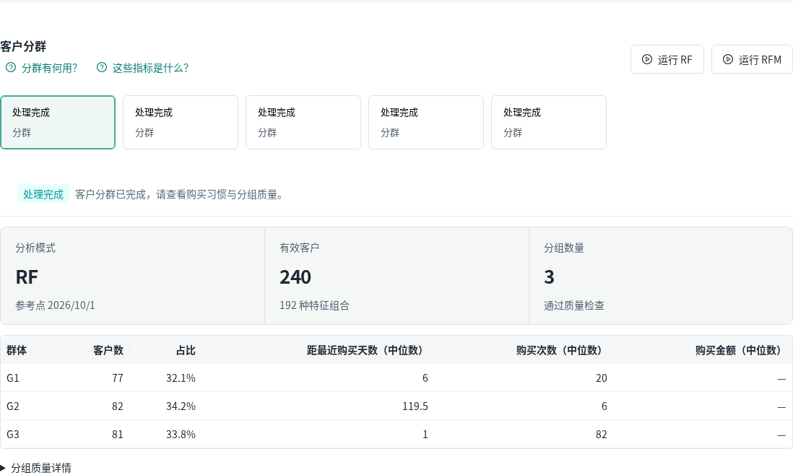
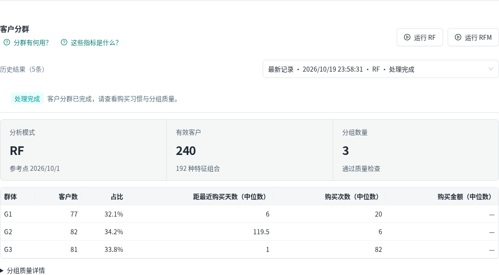
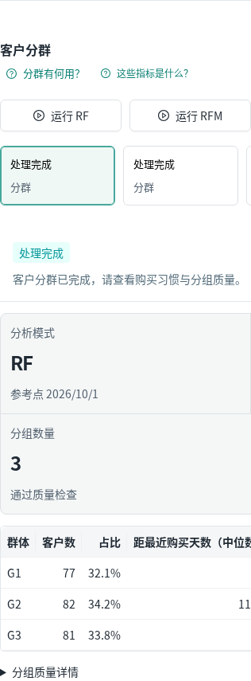
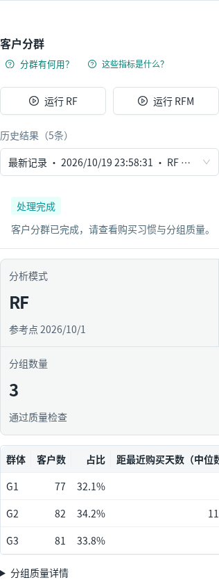

# 分析历史展示整理

2026-10-20（中国时间）。基线main 47e6252271092c7a02dd9c4c6c2aa558c63b1ef8，分支fix/analysis-history-display，产品修复d4c7d3dde9b64e79175afdb65f01934e7740d684。应用0.6.3/schema5/sales-v2.2.0不变。

## 复现与改动

真实浏览器复现用户截图：客户分群5张卡片全部只显示“处理完成/分群”，共购2张只显示“处理完成/关联规则”。它们是历史运行入口，并不是客户类别。列表摘要没有分析参数，原界面不能据此准确标RF/RFM；也未显示时间，因此无法辨认。

新增统一AnalysisHistory组件，将两个面板的历史入口各收为一个“历史结果”下拉框，显示记录顺序、创建时间（浏览器本地时区）、状态；当前已读取记录有可靠参数时补充RF/RFM，未知不猜测。默认选择、切换回调、任务轮询、提交/取消、能力限制、错误与结果、算法参数不变，所有旧结果留存。下拉只读取历史，不运行分析。无新增解释段落、数据库/API/算法/AI/依赖/导出修改。CSS只作用新组件。

后端列表既有默认最多30条、且前端按质量检查记录筛选的行为保持原样，本次未增加历史分页；“5条”为当前读取的记录数，不称全部历史总数。数据未删除或合并。精确展示合同仅新增import和两个明确的入口替换，整份QualityReport非展示逻辑仍做完整比较。

## 真实验证

- TypeScript/Vite构建、18项Node合同PASS；保留既有约1MB data chunk提示。QualityWorkspace仅增加约0.4KB原始/0.28KB gzip，未新增依赖。
- 8组专项PASS：1440/1280/768/390面板及下拉范围、5条分群/2条共购逐个切换并读取对应run响应/界面、Enter/方向键/Escape与焦点、7份历史结果完整一致、打开切换无写请求、无脚本错误。
- 9组完整CSV真实浏览器PASS：新建/上传/字段/分类/月报、商品异常/来源/备注、库存、真实CPU AI（ai_used=true且证据匹配）、HTML/CSV/JSON/打印PDF、质量及RF/RFM/共购均发布。
- 17项确定性对账PASS：冻结月报完整结果与导出、fresh summary/products/forecast/anomaly/quality/notices/库存、14次写请求字段及次数一致。66,434.40CNY/10,640件；七天177、库存10+到货7/备用3/包装6得到168。冻结result SHA256 221fc60b179b6e930f0871a04134afb3a34724029f3b3e8a5835cc67df989f2c。
- 新项目2ce20211-f233-4680-8036-3d954d5f3ba7、数据版本15600ad2-0ad5-44ca-ad04-97f36d502c1a、销售runa83a094e-8105-49a3-8686-2cacb6902552。输入青禾完全模拟CSV SHA256 e34d6cf870876e2baff8af00e45a74e70cea5a5a228f603fad21f30258425923；不是商户试用或经营收益证据。

命令：`node --test scripts/ui_redesign/test_presentation_contract.cjs scripts/ui_redesign/test_report_guidance.cjs scripts/ui_redesign/test_whole_presentation.cjs scripts/test_ux_guidance.mjs`；`npm run build -- --configLoader runner`；`node scripts/ui_redesign/browser_analysis_history.cjs`、`node scripts/ui_redesign/browser_e2e.cjs`。浏览器带RETAIL_TEST_ROOT/RETAIL_BASE_URL/RETAIL_HISTORY_PHASE和既有Playwright/fontconfig运行时；HOME/TMP/XDG/npm缓存全部个人隔离目录。原始脚本/环境/日志在个人updates/analysis_history_20261020_01，D盘同名任务tools/logs/evidence。

首轮测试定位到两个收起动画同时可见的弹层、次轮使用旧版内部selection类导致自动化失败；保留attempt1/2为FAIL尝试。按aria-controls锁定对应弹层并读取当前安装组件实际文字后重跑8组PASS，未减少断言，未把失败冒充通过。没有因此修改产品或隐藏错误。

本补丁NOT_RUN：全后端pytest、XLSX/全部帮助主题、原生200%缩放、完整权限/长时任务矩阵；其代码未改。已往测试不代替本次，未做真人商户研究。

## 前后截图（同项目/质量记录/视口，真实面板截图）

|视口|改前|改后|
|---|---|---|
|1440|||
|390|||

## 发布与回退

不改共享AIC_Project、库或服务。独立个人18106与本机18115；旧18114/47e6252保留回退。正常main推送后从实际fetch SHA再次干净检出、构建和重跑17组浏览器及17对账，最终发布证明为本任务release2/evidence/release_receipt.json，不能用本候选测试或进度文件提前认定。保留SQLite在线备份，integrity=ok/FK0及SHA在isolation.json，恢复已在独立库检查。

没有C盘主动项目写入或批准例外；缓存/临时/profile与下载截图均D盘或远端个人目录，既有认证只读使用、严格主机校验。无法保证系统与Codex后台绝对零写入。回退直接使用旧18114，或仅停止本任务re-analysis-history；无需还原业务数据库。

## 新记录刚提交的补充检查

最终复查补充：列表尚未刷新时，已提交且与当前选择一致的detail先作为显示记录纳入下拉，列表刷新后按同一ID去重，防止短暂露出内部UUID或“还没有记录”。不改变API/任务/状态。真实RF/RFM/共购提交均在两次浏览器绘制后检查历史区域已显示且不含新run UUID；增强原E2E断言，8专项+9完整流程、18Node/构建、17对账再次PASS。最终干净复验改用release2，最初release/ac751c2及candidate_ac751c2证据只为历史阶段。
