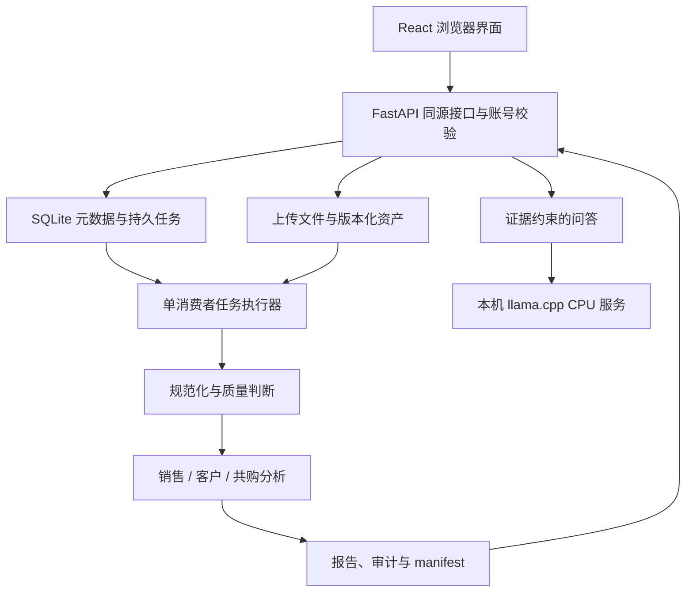

# 技术架构

## 组成与数据流

浏览器负责交互、人工确认和结果展示；服务端负责归属检查、输入冻结、计算、持久化与导出。大模型只辅助解释已计算证据。数据库记录对象关系和任务状态，文件系统保存原始文件、规范化表和运行产物，两者均需纳入备份。

## 目录职责

| 路径 | 职责 |
| --- | --- |
| `backend/app/main.py` | 应用生命周期、路由装配和静态入口 |
| `backend/app/settings.py` | 运行路径与资源配置 |
| `backend/app/models.py`、`database.py` | 元数据模型、数据库初始化与兼容性 |
| `backend/app/auth.py` | 账号、密码、会话与请求访问约束 |
| `backend/app/task_runner.py`、`task_registry.py` | 持久任务执行、分派、取消与发布 |
| `backend/app/analysis_inputs.py` | 已发布质量输入的上下文与摘要校验 |
| `backend/app/retail_api.py`、`retail_schemas.py` | 销售请求合同与项目资源接口 |
| `backend/app/retail_engine.py`、`sales_mining_v3.py` | 销售统计、数据范围及分析 |
| `backend/app/sales_assistant.py`、`retail_export.py` | 证据问答和报告输出 |
| `frontend/src/` | 页面、字段确认、分析工作区、帮助内容与样式 |
| `scripts/` | 启动、数据准备及专项验证 |
| `docs/` | 用户、部署、接口、算法与验证文档 |

## 访问与版本边界

账号通过会话访问自己的项目。资源接口逐层核验项目、版本和运行归属；修改请求还需要同源约束与约定请求头。前端隐藏入口不是权限机制。

一次分析固定输入版本、映射、口径和参数。修改字段或分类产生新配置/运行，不覆盖原始行。来源行标识和摘要连接报告与原数据。备注、行动处理状态和库存确认是可编辑业务记录，不能把它们与冻结统计输入混为一谈；读取时形成的展示不保证所有导出文件永远字节相同。

## 任务与资源

Web 使用单 Worker，重任务通过持久队列及受控子进程运行，具备幂等、取消、超时、内存监控与终态记录。完整产物与 manifest 发布后才作为下游输入。失败、不适用和成功是不同状态，文件存在不等于运行成功。

AI 使用独立回环服务、单推理槽和受限上下文。模型不可用时可以回退到确定性事实说明；回退状态需要明确展示。部署配置见 [DEPLOYMENT.md](DEPLOYMENT.md)，扩展约束见 [analysis-extension.md](analysis-extension.md)。
