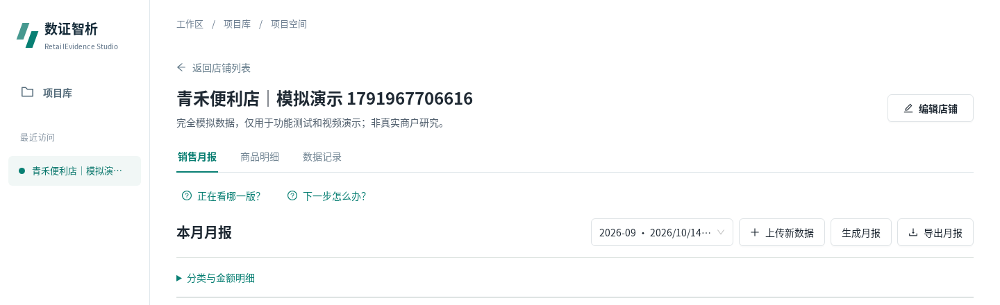
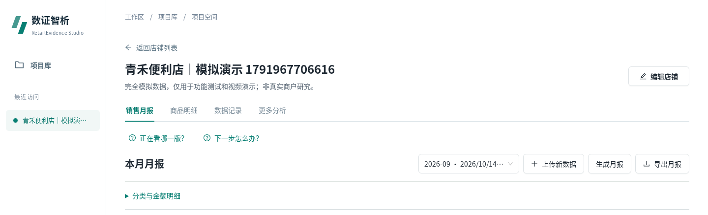

# 更多分析：固定顶部导航

2026-10-19，基线main/原18113预览0cca4e4f777d0bcc76c1fe17b2680dbc41f87174。产品修改提交c1924c4de6b403f86443b73adfb568f45b0b1e27，分支fix/more-analysis-navigation。应用0.6.3/schema5/sales-v2.2.0不变。

## 改动与保护

原顶部链接只有进入quality页面才渲染，月报底部提供入口。现将同一NavLink无条件显示为第四项：销售月报 / 商品明细 / 数据记录 / 更多分析；移除月报底部重复链接，保留助手按钮。沿用原/projects/:projectId/quality及原组件，不改变分析页、请求、参数、默认值、禁用/确认条件、任务或数据。不重写导航、不新增计算。历史run参数和浏览器前进后退保持原行为。

产品仅frontend/src/pages/RetailProjectSpace.tsx和components/SalesWorkspace.tsx两文件。测试中原“页面壳完全不变”约束改为“完整源码只允许这一条明确导航编辑”；其余完整组件/API/后端保护不放宽，未删除断言。无CSS/依赖/后端/数据库/算法/AI或导出变更。

## 真实复测

- 18项Node检查PASS、TypeScript/Vite构建PASS（既有data大chunk警告保留）。
- 6组导航浏览器PASS：1440/1280/768/390分别遍历四页面，全部同一行、顺序和选中项正确、无主体溢出；键盘Enter进入/刷新分析页/返回原run；冻结月报、质量、RF、RFM和共购五个result保持，点击导航没有触发分析或写请求。
- 6组原guards PASS：历史选择/刷新/复制/前进后退、月汇总受限、商品搜索排序/返回、帮助焦点、字段草稿、无效报告和隔离请求失败恢复。
- 9组完整CSV浏览器PASS：真实上传/字段/分类/范围/月报、商品异常来源、备注、库存、真实CPU AI、HTML/CSV/JSON/PDF、质量、RF/RFM和共购发布结果。新项目f4991096-0947-4459-ae66-b054b2eddbff、版本7bf4e3e6-659d-4336-a2e4-0c8ea0cd42f2、run24570091-d4a2-47a2-9802-174ad1dc063a。
- 17对账PASS：完整冻结result、7导出/manifest和HTML、新summary/products/forecast/anomaly/quality/notices/库存，14次业务请求字段与次数一致。66,434.40CNY/10,640件；七天177、库存10/到货7/备用3/包装6→168。输入为已有公开的青禾完全模拟包，CSV SHA e34d6cf870876e2baff8af00e45a74e70cea5a5a228f603fad21f30258425923，不是真实经营收益。

候选浏览器21组PASS/0FAIL/0BLOCKED；基线5组只用于定位，不计修复通过。原始命令：node --test scripts/ui_redesign/test_presentation_contract.cjs scripts/ui_redesign/test_report_guidance.cjs scripts/ui_redesign/test_whole_presentation.cjs scripts/test_ux_guidance.mjs；npm run build -- --configLoader runner；node scripts/ui_redesign/browser_more_analysis_nav.cjs、browser_ui_guards.cjs、browser_e2e.cjs。后3项带显式RETAIL_TEST_ROOT/RETAIL_BASE_URL及既有Playwright/fontconfig个人runtime；HOME/TMP/XDG全部个人目录。规范小收据见verification/more_analysis_nav，完整截图/日志保存在本轮隔离任务evidence。

NOT_RUN：本补丁未重跑全部后端76单测、XLSX/全部42帮助/原生200%/完整权限与长时任务矩阵。相应代码未改，之前报告仅作为历史，不冒充本次通过。没有真实商户研究。

## 真实截图（相同项目/run与视口，裁取页头）

|视口|改前|改后|
|---|---|---|
|1440|||
|390|||

## 发布与回滚

不修改共享AIC_Project或其数据库/服务。使用远端个人updates/more_analysis_nav_20261019_01、独立回环18105，Windows D盘Git与证据；SQLite在线备份integrity=ok/FK无问题，SHA见外部isolation.json。原18113/0cca4e4保留作为回退。新版独立入口采用本机18114→18105，必须以实际HTTP构建SHA/发布收据核实，不能以文档提前认定已启动。

测试后正常推送main并fetch，再从该实际远端SHA干净检出构建、重跑关键导航/完整流程。最终SHA、原始测试及served-assets哈希由个人任务release/evidence/release_receipt.json和Windows evidence/release记录；此前候选工作树运行metadata仍0cca，不能当最终部署证明。

没有C盘主动项目写入或批准例外；临时/cache/profile均D盘或远端个人目录。不关闭主机校验，不使用其他GitHub账号，不复制凭据上服务器。无法保证操作系统/Codex自身背景绝对零写入。回滚可直接打开原18113，或仅停止本任务re-nav-preview，不恢复/覆盖数据库。
