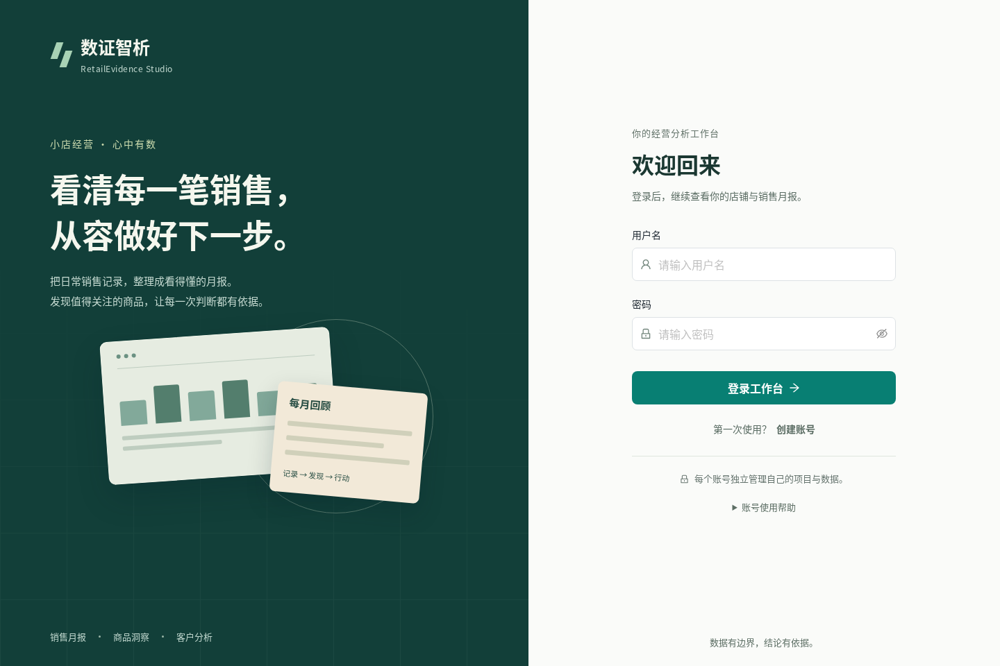
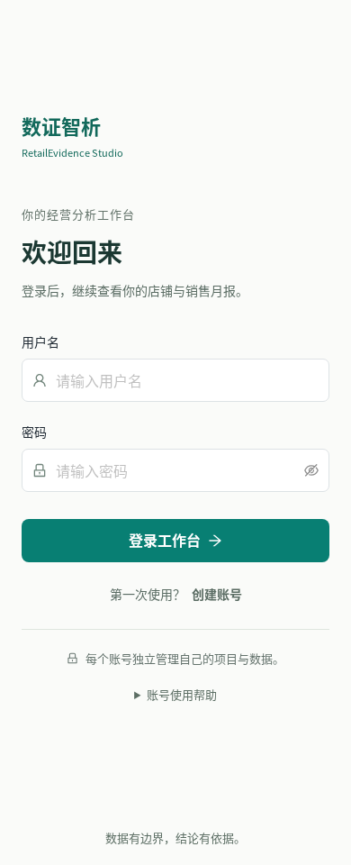

# 系统修复与界面细化：前后对照

记录日期：2026-10-23。基线为 `7b225be22ccdba811e9bdfd8c0610aca82083915`（0.7.0）；改后是 `feature/system-polish` 的0.7.1候选工作树。这里的截图和专项测试先于最终发布提交，最终提交及干净检出验收以 [系统验收记录](SYSTEM_REVIEW_ACCEPTANCE.md) 为准，不将候选截图冒充最终提交重跑。

## 数据、身份与可比条件

月报及商品图使用同一模拟项目 `0f859538-68ca-43ef-be40-1344e5d990d3`、同一冻结报告 `49527609-e9f6-4292-a972-678af6552c48`、2026-09。CSV为青禾便利店可复现模拟数据，共17,641行；数据来源和哈希见 [系统复查](SYSTEM_REVIEW_20261023.md)。销售额66,434.40 CNY、数量10,640、商品12、订单1,326。专项在结束时完整比较原报告result对象，保持不变。

登录图使用未登录的独立浏览器资料目录，用户名和密码为空，无账号、会话或商户数据。仅两张改后匿名登录图进入Git。含合成测试用户名的业务原图、测试JSON与日志保存在D盘受控证据目录，未复制浏览器profile/cookie，也未对原图涂抹或用生成图片替代。

本地证据根目录（下表简称 `E`）：

`D:\AIC_RetailEvidence_Work\delivery_20261009_01\system_polish_20261023_01\evidence\focused_browser_after`

远端证据在个人任务 `updates/system_polish_20261023_01` 下：`baseline_browser3/evidence/clean`、`after_focused4/evidence/system-polish`、`after_visual_final/evidence/visual`、`after_visual_viewport`、`after_matched_viewports`。这些是受控环境证据位置，不是公开网页入口。

## 对照与实际观察

| 页面 | 改前文件（相对E） | 改后文件（相对E） | 视口与比较边界 | 已查看的具体变化 |
|---|---|---|---|---|
| 月报桌面 | selected/baseline_browser3/evidence/clean/account_report_1440.png | visual/after_report_1440.png | 同项目、同run、1440×1000，fullPage | 深青侧栏与浅色主区分层；稳定的顶层导航选中态；金额区与操作条更明确。页首两条帮助收进“月报使用帮助”；原数字、图表日期、商品及两条行动保留 |
| 月报窄屏 | selected/baseline_browser3/evidence/clean/account_report_390.png | selected/after_matched_viewports/after_report_390x844.png | 同项目、同run、390×844，fullPage | 四个导航入口仍可见；报告选择、上传、生成和导出换行；金额和单位完整；主体不横向溢出。宽表格在自身容器滚动，没有删除数据列 |
| 商品桌面 | selected/baseline_browser3/evidence/clean/06_all_products.png | visual/after_products_1440.png | 同项目、同run、1440×1000，fullPage | 搜索、变化和分类筛选、商品状态、12件商品及分页保留；数字列对齐、表头与边界更清楚 |
| 商品窄屏 | 无本轮相同页面的改前390截图 | visual/after_products_390.png | 改后390×1000；不宣称严格前后对照 | 搜索和筛选换行，长商品名可换行；宽表格独立横向滚动，整页宽度不增加。滚动后才能看到右侧列，是明确保留的窄屏限制 |
| 映射表单 | selected/baseline_browser3/evidence/clean/02_mapping.png | selected/after_visual_viewport/after_mapping_viewport_1440.png | 都是1440×1000，但改前为首次导入且滚动到业务口径，改后为创建新字段版本顶部；不做像素级或同状态比较 | 字段标签与帮助按钮分离；已映射字段的原始样例仍在，业务确认要求保留。标签聚焦与帮助行为由真实键盘测试证明，不只凭截图 |
| 映射窄屏 | 无本轮同状态改前图 | selected/after_visual_viewport/after_mapping_viewport_390.png | 改后390×1000，仅视口截图 | 抽屉顶端y=0，单列输入/帮助正常，底部确认栏保留；内容需要在抽屉中纵向滚动 |
| 登录桌面 | selected/baseline_browser3/evidence/clean/login_1440.png | selected/after_matched_viewports/after_login_1440x960.png | 同为匿名空表单，1440×960 | 延续已有品牌和背景，控件高度、文字与间距统一；没有宣称重新设计整套登录背景 |
| 登录窄屏 | selected/baseline_browser3/evidence/clean/login_390.png | selected/after_matched_viewports/after_login_390x960.png | 同为匿名空表单，390×960 | 主要表单与注册入口保持清楚，账号帮助按需展开，无主体横向溢出 |

最初改后截图采用1000px高度；为可比性，另补拍960px登录和844px窄屏月报，并保留原始截图。没有重拍旧版本来替代基线。

固定抽屉的 `fullPage` 截图可能把当前视口之前的页面也拼入，使抽屉看起来从整页中段开始。因此 `visual/after_mapping_*.png` 只作原始捕获记录，布局判断使用 `selected/after_visual_viewport/` 两张视口截图；实际几何检查表明抽屉顶部y=0、宽度不超视口。此捕获差异没有被误记为产品缺陷。

## 可直接查看的匿名登录图

1440×960：

390×960：

## 功能与弹层复测

`system-polish/results.json` 为本次完整专项：12 PASS、0 FAIL、0 BLOCKED、0 NOT_RUN；执行于2026-10-23 17:21–17:23（北京时间），页面未捕获错误0。故障注入与真实正常请求在结果kind中分别标记。

- 短暂 `/auth/me` 500：草稿保留；重连遮罩挡住旧保存按钮；Tab/Shift+Tab焦点限制在重连层；Escape不关闭底层编辑窗；真实重连后编辑窗仍可见、原说明仍在。
- 历史报告经过数据记录/更多分析后返回、刷新及前进后退，run保持一致。
- 真实AI、原始记录、库存和检查请求被人为延迟交付后，旧结果不会进入新报告、商品或新输入。AI实际为 `ai_used=true`、`mode=model_inference`，evidence_id与原run/分类哈希一致。
- 修改库存后必须重新确认；月报提交后修改月份或关闭重开，不会由旧回调抢走当前设置。
- 数量单位标签聚焦输入，不会误开帮助；帮助空格/Enter、Tab、Escape、关闭后焦点返回与草稿保留通过。商品→依据→帮助的叠层经过真实命中测试，帮助未被底层抽屉遮挡。
- 1440、1280、768、390布局及720 CSS像素/2倍设备比例的200%等效布局通过；后者是等效布局检查，不冒称原生浏览器菜单缩放。

之前失败尝试保留：基线异步问题、重连焦点逃到BODY，以及测试定位遇到历史下拉虚拟滚动、“取 消”可访问名称和相对locator问题均有日志。只修正真实定位方法，没有删除或降低功能断言；最终使用全12组的 `after_focused4` 结果。

以上属于开发自查，不等于真实商户研究、全系统绝无bug或最终审美确认。浏览器主流程、后端单测、账号隔离、导出与最终SHA复现另见验收文档。

## 文件清单与SHA-256

下列路径相对E。文件按原始字节核对；所有表内截图已逐张查看。两张Git登录图与对应 `after_matched_viewports` 原图字节完全相同。

| 证据文件 | SHA-256 |
|---|---|
| `selected/baseline_browser3/evidence/clean/account_report_1440.png` | `1e3a1bfe342b5d46aeeef8c8c2bad484a8c88f2d99b9c0250ea680cea1b38d75` |
| `selected/baseline_browser3/evidence/clean/account_report_390.png` | `d4694b3ef884484f8bcbfabd59451fb1e12470661fee6fdf01b738c9924d85a9` |
| `selected/baseline_browser3/evidence/clean/06_all_products.png` | `63277bcb4d7c6f1303e84d9e455ba7b196b4b11af2e3e10e39f0359528a05b4e` |
| `selected/baseline_browser3/evidence/clean/02_mapping.png` | `9a1b7d6e4b7bc9599f6e3d7e424f9cb62735de7b4e32fc2459d8a0973f140df4` |
| `selected/baseline_browser3/evidence/clean/login_1440.png` | `52650824de7c2a3a6905c64363531f86c6c27c8deb8941a559c0bbe0f6cd5c32` |
| `selected/baseline_browser3/evidence/clean/login_390.png` | `20daef92019caa2d72d37fa113d4ea029c2acf61709e08eef967a50c9bba3a02` |
| `visual/after_report_1440.png` | `ed791cd24b55533eac3dc479c767827d24e22113189a847ec79dcf40ba1d8e58` |
| `visual/after_report_390.png` | `37e23d215da1c9888d34b5d5620b6c82463f784be2cc00c672965c128b8a0350` |
| `visual/after_products_1440.png` | `dcdec53bac7250d257a67344a5ba9baf3df8b5917a9573f3c03d0d0534458b1e` |
| `visual/after_products_390.png` | `079b3cdde7b9bcc0f2bd6bceefb648c40a2ce10af53926d9272da2edeb413399` |
| `visual/after_mapping_1440.png` | `a6f5b891663d4fe86e2b6e04e1ff286d754a82ce8dd91b678ff2453a74cb5ee5` |
| `visual/after_mapping_390.png` | `b0e10c1806bef984316af0a2c980472444d381d5949635c62636dfcb72558bf8` |
| `visual/after_login_1440.png` | `5bc6167bdcfbf9f415b09bf4085686a89b45a6b22e6cf63ba75b0de530272e51` |
| `visual/after_login_390.png` | `966087762572cb346e8c1845849e1554c9e5bbdf83941458076eac57701a96e9` |
| `selected/after_visual_viewport/after_mapping_viewport_1440.png` | `23ec3d95ca188a3cd81d5dc409a37239cbe70cecc06806876b67b31952b0c8c2` |
| `selected/after_visual_viewport/after_mapping_viewport_390.png` | `af32a83c097328e87d33327358eb7d0d77eeec1b93fae6675f23926dd37c7e08` |
| `selected/after_matched_viewports/after_report_390x844.png` | `37e23d215da1c9888d34b5d5620b6c82463f784be2cc00c672965c128b8a0350` |
| `selected/after_matched_viewports/after_login_1440x960.png` | `6e2f880a19f7f23e069682da37e6071615e73cee6bbfbfe6c9e78044cfeb4622` |
| `selected/after_matched_viewports/after_login_390x960.png` | `127dab80644522cbfa43f77d522b22b1f154b07bc280b0ba257fe1677bf8ec6a` |
| `system-polish/results.json` | `38ada8fd54533967f2b85f9afe44e4217404054862a8a921afca7671b6bd047f` |
| `system-polish/auth_focus_trace.json` | `6764d3535de7c7aedaff9c8b7409324bc34831a6c963639b848a8e065920cccd` |
| `system-polish/delayed_ai_metadata.json` | `ab7df0c964bd4bf6408ba24c64f34d12561a65ad7865f9b9f142a033f6b1174b` |
| `visual/visual_receipt.json` | `a147198d065d6196126529864164038be0a5dc0ae44ebc75a0a0cd3489be653b` |
| `selected/after_visual_viewport/receipt.json` | `ac81fdfba1b72c0bcc26cb1b293cd3efc9dd12ec1c73dd68c010c4ed337f0f11` |
| `selected/after_matched_viewports/receipt.json` | `3c06f8ded47fc181194865f0406302d42de0be79b4ffdcd9794fd297e0d41c32` |

本次新增源码文件：`scripts/browser_system_polish.cjs`（SHA-256：`0b542eb650f3648b63b1fea70dba8b2250b8250472074eec55bd63d4a44c1788`）。本对照交付还包括此文档和 `docs/images/system-polish/login-desktop.png`、`login-mobile.png`；不包含profile、cookie或认证请求。
