# 三类样板：同报告前后对照

2026-10-19；基线160a90c，最终样板7b61d84，应用仍0.6.3。下列均实际运行截图，完全模拟数据，无Mock、设计贴图或私人商户资料。原图完整清单见verification/ui_redesign/screenshot_manifest.json，全部40张位于D任务evidence/before_v2、after_v2及远端同目录；仓库仅选取14张供评审。1440/1280/768/390均测试，正常/受限/错误证据另见验收。

固定项目8bf9d58c-9ac4-48aa-9f42-6644d4f5a64a，版本079c4221-28b1-460c-9df2-be174312d824，run35cf3631-064c-4a90-a845-b06485eb9a3e，2026-09。截图宽度记录在文件名，高1000视口；月报/商品为fullPage，详情/分类为当前视口，超出部分可在原抽屉滚动。

## 实际入口

- [原版月报](http://127.0.0.1:18110/projects/8bf9d58c-9ac4-48aa-9f42-6644d4f5a64a?run=35cf3631-064c-4a90-a845-b06485eb9a3e)
- [样板月报](http://127.0.0.1:18111/projects/8bf9d58c-9ac4-48aa-9f42-6644d4f5a64a?run=35cf3631-064c-4a90-a845-b06485eb9a3e)
- [样板商品列表](http://127.0.0.1:18111/projects/8bf9d58c-9ac4-48aa-9f42-6644d4f5a64a/products?run=35cf3631-064c-4a90-a845-b06485eb9a3e)，搜索P006后点击食用油500ml看详情。
- [样板分类表单](http://127.0.0.1:18111/projects/8bf9d58c-9ac4-48aa-9f42-6644d4f5a64a?run=35cf3631-064c-4a90-a845-b06485eb9a3e&compose=1)。截图测试临时清除已有规则后填两条实物精确规则，均未保存；可自行添加规则查看布局，原报告不变。
- 受限状态：项目af729623-6e6a-436b-b7fc-4ebdfa6b5a31/run6192b66d-22e1-4c35-b47c-32788e76fb00为月汇总，无日曲线；错误状态在分类添加空规则，原检查/生成门槛保持。

## 1. 销售月报，1440

统一指标表面和数值、减少页头空间、品牌链接/细线分组。金额分项、风险/未知提示仍在指标前；原月份/历史/生成/导出/帮助/更多分析入口均保留。

|改前|改后|
|---|---|
|||

## 2. 商品列表和详情，1440

保留完整表格，数字右齐，说明可换行且完整；局部横滚，不转成商品卡。详情中本月数值、异常/原始记录、七天参考、库存/备注/AI/依据保持原次序，叠层不变。

|改前|改后|
|---|---|
|||
|||

## 3. 业务分类规则，1440

每条规则有可见标题/五个标签，桌面两列，窄屏原DOM顺序单列；删除/新增/确认仍在原流程。不更改类型/金额含义、匹配优先级、版本冻结、错误校验或旧报告。

|改前|改后|
|---|---|
|||

## 4. 窄屏与错误状态

390月报保持14px正文，主要数字26px；历史选择整行，原操作均有文字。分类错误提示和禁用态保留，不靠隐藏错误换整洁。

|改前|改后|
|---|---|
|||
|||
|||

样板已完成工程回归，**样板方向已获用户确认**；以上保留原样板对照，下面记录已按同方向完成的全站推广。

## 用户样板反馈：说明按需展开（2026-10-19）

本轮针对常驻解释过多的反馈已实施并复测，详见[说明收纳修订及真实截图](UI_REDESIGN_COPY_REFINEMENT.md)。9项前端检查和16组浏览器检查通过。仅两条固定说明转入帮助，动态风险直接显示；其余表格与依据可点击展开。该段为样板反馈历史；用户随后已批准继续全站，当前结果见下方及最新验收。

## 全站推广（用户确认后，2026-10-19）

同一40ad批准版本作为剩余页面改前，c0ab33a产品为改后。空态/项目/上传/解析/映射/数据/质量28对截图逐张复核，固定项目与版本不变，项目编辑与草稿只使用隔离fixture。完整原图和viewport记录在TASK/evidence/whole-site/whole-before、whole-after；仓库选8对。实际全站入口为最终收据对应的[独立全站月报](http://127.0.0.1:18113/projects/8bf9d58c-9ac4-48aa-9f42-6644d4f5a64a?run=35cf3631-064c-4a90-a845-b06485eb9a3e)，与原18111样板分别保留。

项目库用紧凑行列表；上传保持步骤和按钮，说明靠近原帮助；映射标签与帮助对齐；已保存原始预览和字段AI按需展开；质量/RF/RFM/共购数值分组、右对齐，范围与过程按需展开，真实错误和限制直接显示。

|页面/视口|改前|改后|
|---|---|---|
|library / 1440|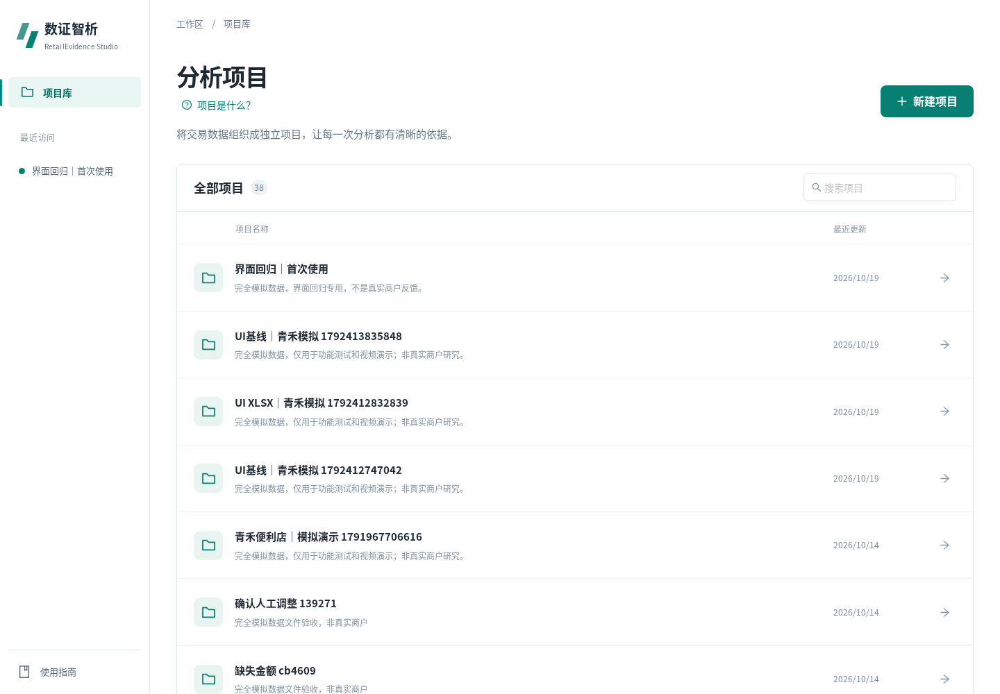|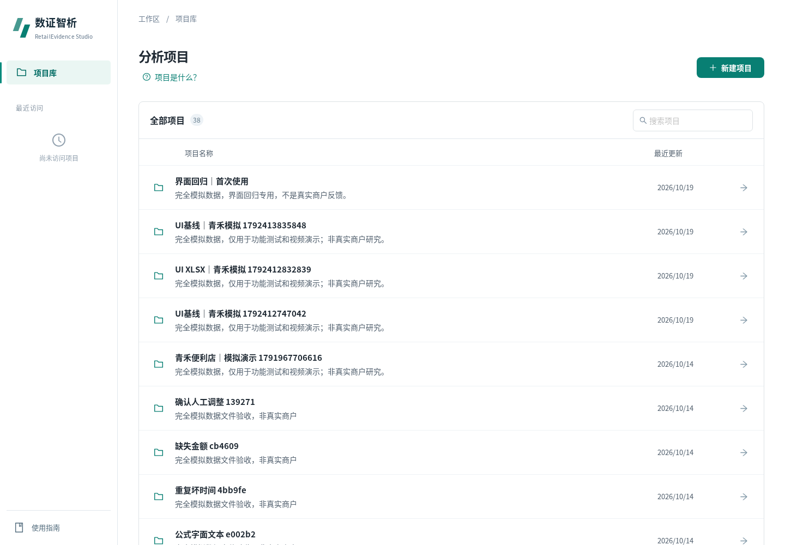|
|library / 390|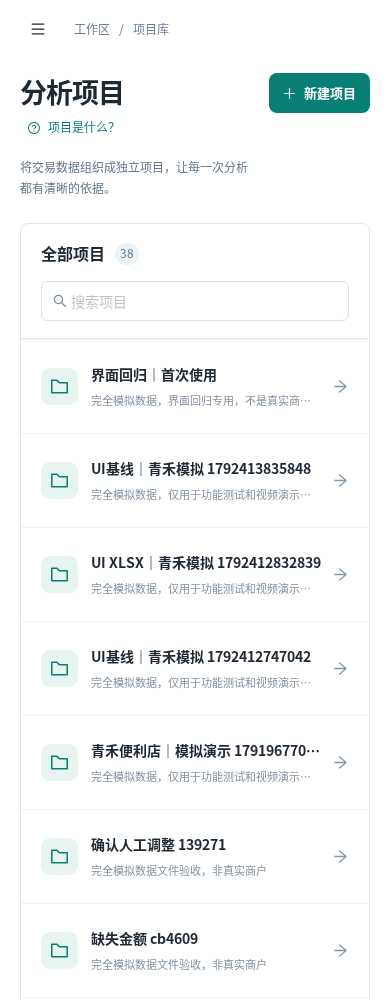|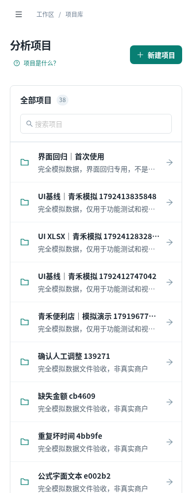|
|upload / 1440|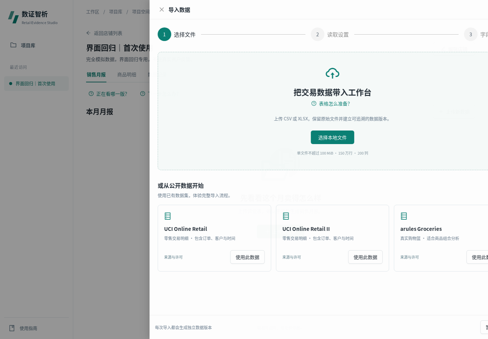|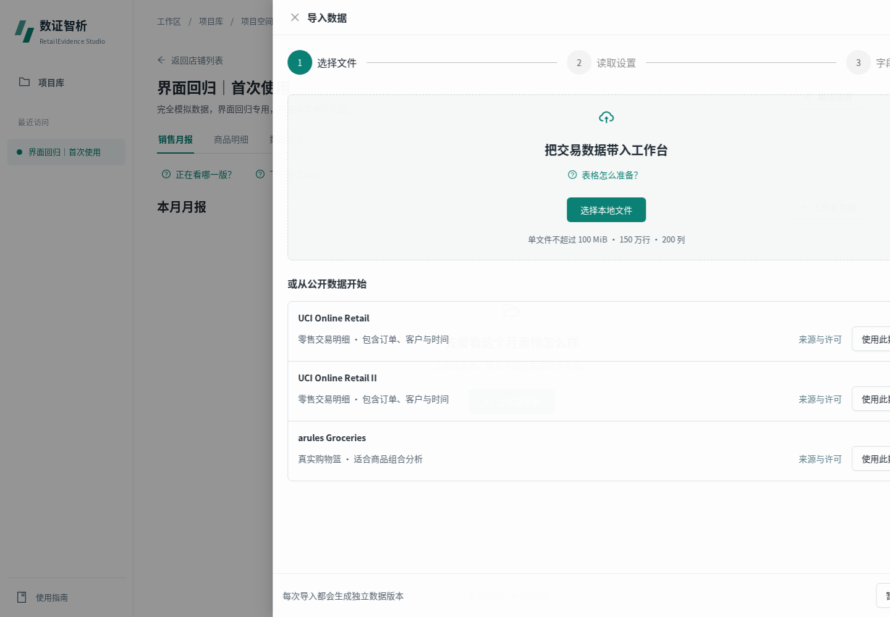|
|upload / 390||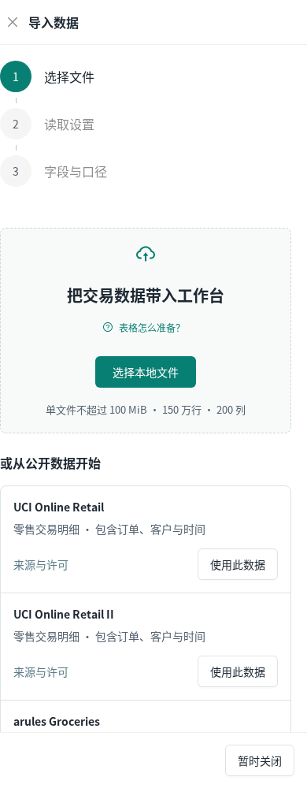|
|mapping / 1440|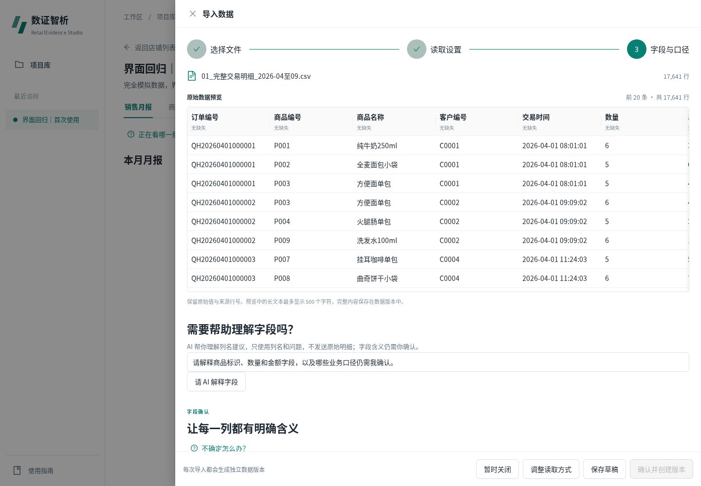|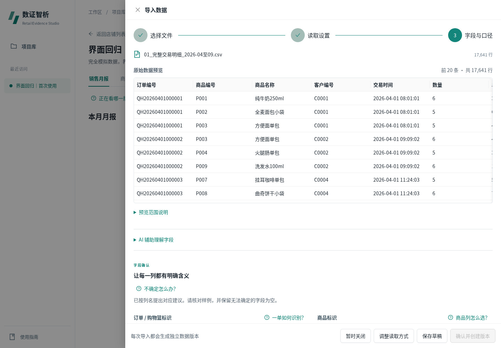|
|mapping / 390|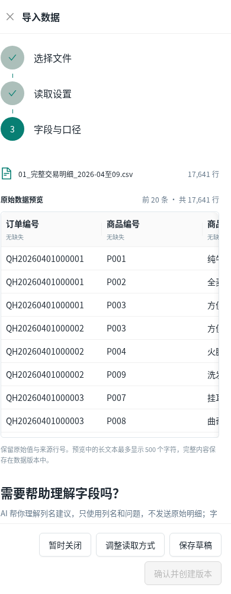|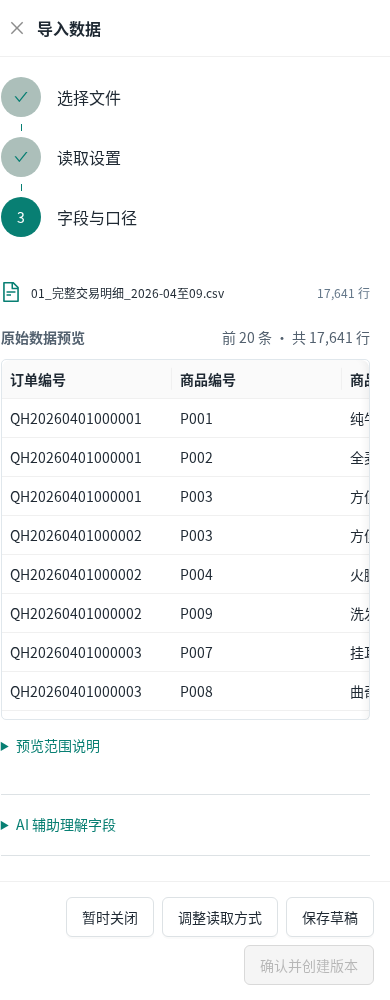|
|data / 1440|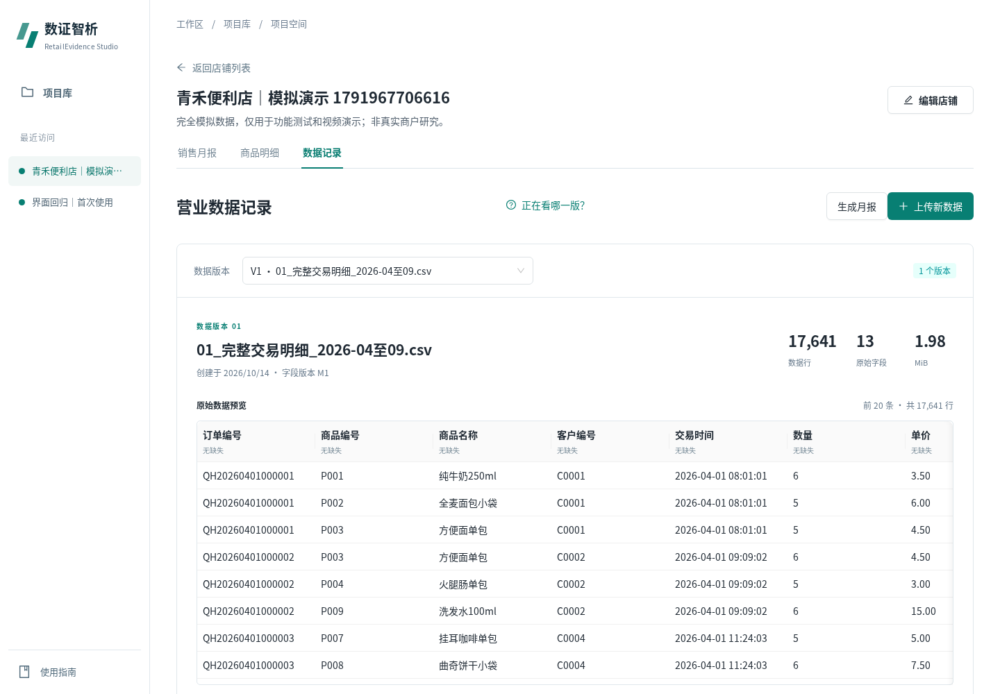|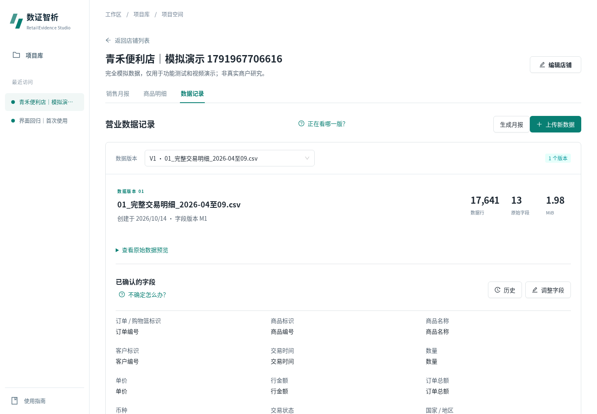|
|quality / 390|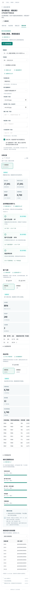|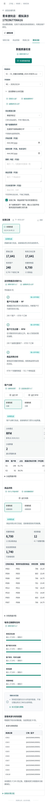|

没有改变导航或算法；全部原始明细、业务分类、备注、帮助、客户分群及共购可达。原生200%、PDF逐页检查和50浏览器组结果见[本轮验收](UI_REDESIGN_ACCEPTANCE.md)。
