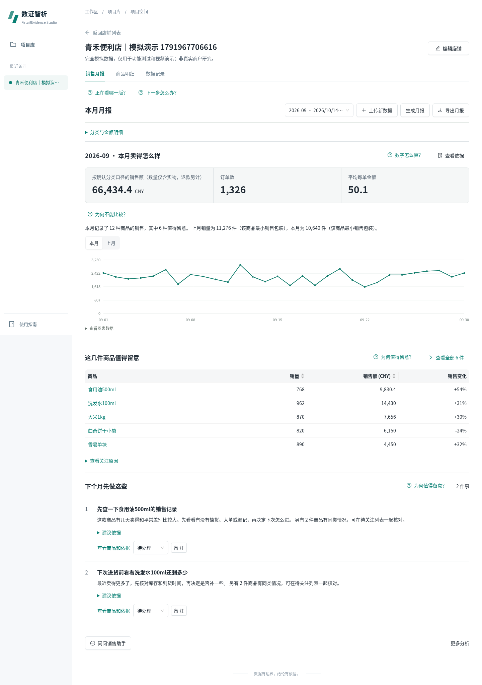
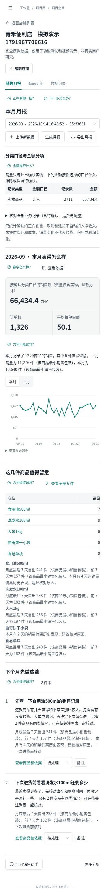
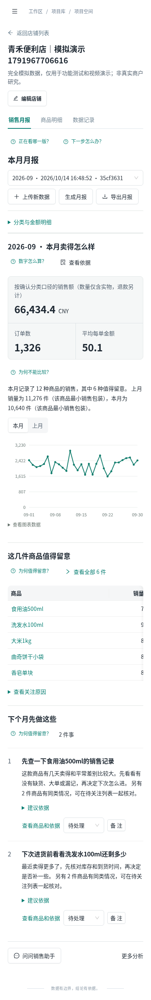

# 样板反馈修订：减少常驻说明

2026-10-19；基于a35ba1b，应用仍0.6.3。用户反馈月报解释性小字过多。仍在feature/commercial-ui-refresh样板确认阶段，尚未批准全站推广或main合并。

## 实际改动

|位置|原来|现在|保护边界|
|---|---|---|---|
|正向销售、库存与成本两条固定说明|每份月报反复常驻|原文放入现有“数字怎么算？”帮助|只精确识别两条固定原文；任何新通知、改写或限制继续直接显示|
|分类口径与金额分项|首页先呈现解释和整张表|“分类与金额明细”默认折叠，点开保留全部原表、业务记录和帮助|待确认业务类型/金额、完整性、重复候选等报告警告不随表格折叠|
|重点商品原因|表格下再次逐条陈列|“查看关注原因”按需展开|原商品、理由、点击入口和排序保留|
|行动建议|正文下再常驻原因和复核说明|标题、行动正文和处理操作直接显示；“建议依据”展开原说明|备注、处理状态与商品详情事件不变|
|分类表单长解释|帮助旁再展示长段落|常驻一句“不清楚的记录保留‘待确认’”，完整原文在分类帮助|规则字段、警告、必选确认、失效条件全部保留|

未用CSS隐藏未知警告；未删除来源证据；后端/API/算法/帮助组件/帮助定义/数据库/导出模板均未改。原生details保留键盘交互，子内容一直挂载，不引入新的表单或请求。

## 本轮实际验收

- tsc --noEmit + Vite build：PASS。
- 前端Node检查9项：PASS，包含整组件展示改动白名单、帮助合同、两条说明精确路由与未知告警默认可见。
- browser_copy_density.cjs：6组PASS，1440和390默认简洁/帮助Enter、Space、Tab、Escape、焦点返回，分类金额与行动依据展开关闭，真实HTML/JSON下载及结果回读。
- browser_ui_guards.cjs：6组PASS，历史切换刷新/前进后退/复制链接，月汇总限制，商品搜索排序返回，帮助键盘，映射草稿，错误报告及网络恢复。
- browser_prototype.cjs：4组PASS，分类1440/768/390标签、下拉、帮助、草稿与确认门槛；200%等效布局（非原生缩放）。
- 六组针对性浏览器中1组使用明确隔离响应注入，验证未知警告仍直接可见；其余正常路径连接真实隔离后端，无Mock替代。
- 当前run与原版完整result一致；下载JSON也逐字段一致。月销售额66434.40 CNY、数量10640、订单1326不变。帮助与展开操作没有POST/PUT/DELETE副作用，未捕获脚本错误0。
- 初次新增测试导出定位失败：Ant图标进入可访问名称“download 导出月报”。保存attempt1原始失败日志和截图，仅修正为语义按钮名称后缀定位后原下载与数值断言全部通过；未改产品逻辑以绕过测试。
- 没有把前轮AI/全部算法/全站测试当成本轮重新执行。原生200%缩放、PDF逐页视觉及完整全站推广验收仍沿用NOT_RUN/待确认。

## 同数据、同视口前后对照

固定项目8bf9d58c-9ac4-48aa-9f42-6644d4f5a64a，run35cf3631-064c-4a90-a845-b06485eb9a3e，2026-09，青禾便利店完全模拟数据。

|视口|改前|改后|
|---|---|---|
|1440|||
|390|||

当前样板仍通过本机18111隧道进入；18110保留最初原版。远端本次修订独立副本updates/ui_refresh_20261019_01/copy-refinement/source。回滚只需恢复本任务start_verified.sh对应a35ba1b构建，无需恢复数据库；不涉及共享正式项目。

执行：`npm run build -- --configLoader runner`；`node --test scripts/ui_redesign/test_presentation_contract.cjs scripts/ui_redesign/test_report_guidance.cjs scripts/test_ux_guidance.mjs`；上述3个浏览器脚本使用既有PLAYWRIGHT_MODULE/浏览器目录及隔离RETAIL_TEST_ROOT环境执行。日志和全部测试产物保存在本任务copy-refinement/evidence，机器摘要见verification/ui_redesign/copy_density_results.json。
