# 操作提示改造前后

以下均为本轮真实Chromium运行截图，非设计稿。初次审查基线0.6.1，后为0.6.2候选；开发者视角的可用性自查，不代表商户研究。原问题与证据保留在UX_GUIDANCE_AUDIT，修复对应见IMPLEMENTATION/ACCEPTANCE。

## 字段与金额（UX06–15，P0）

改造前自动匹配、金额、未知字段需要用户自行理解；现在可在保留表单草稿的帮助抽屉中看到单价5、行金额10、订单总额13的例子，明确整单金额只计一次、未知保留空。全部字段主题实际打开并复测，PASS。

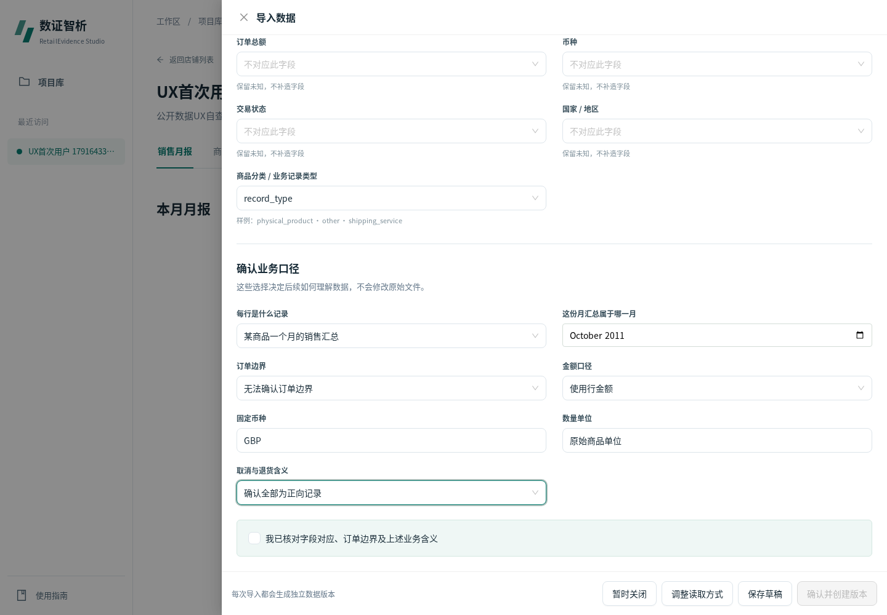
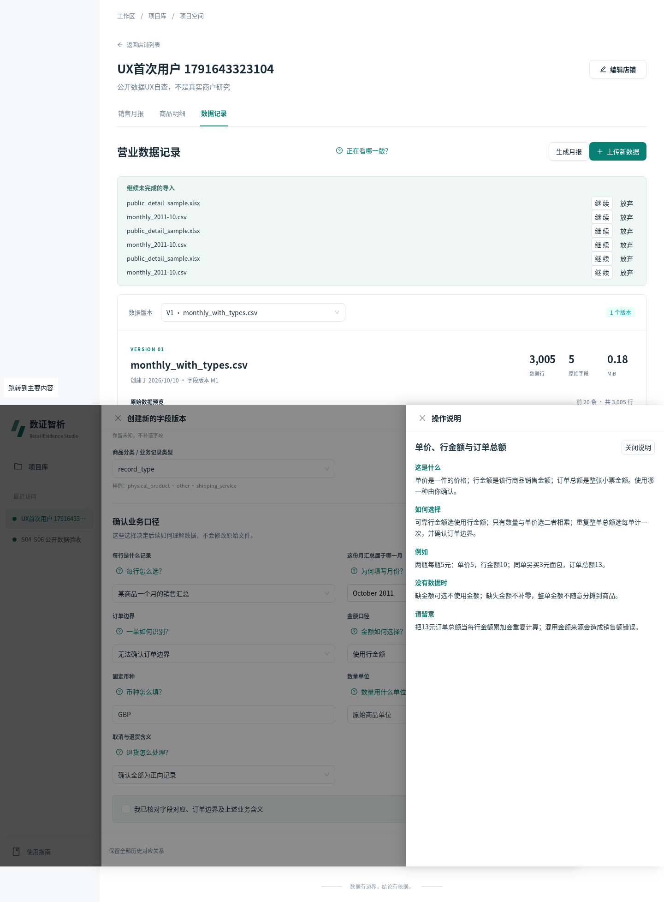

## 记录分类身份与金额独立确认（UX16–20）

每张分类卡显示文件名/V/M；规则空白或精确重复就地说明编号并阻止检查，不能靠帮助掩盖错误。类型和金额分别确认，费用不进入实物建议，原算法不改。PASS。

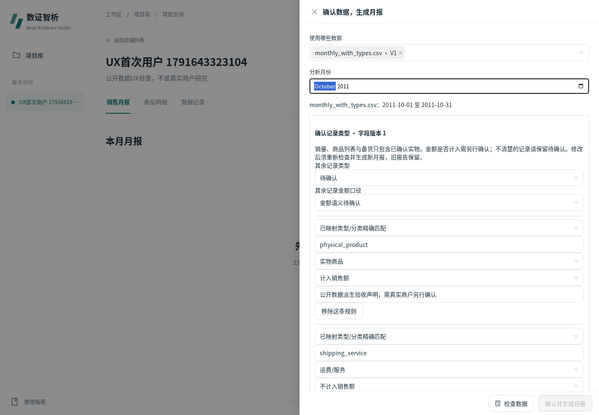
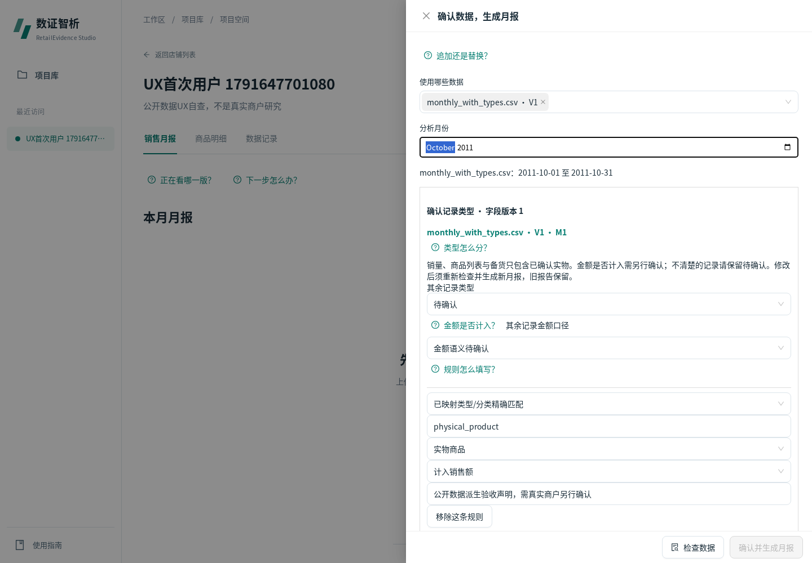

## 历史库存与包装计算（UX33–35，P0）

历史预测起点与今天不同，现在有显式日期警告，不能把今天库存配到2011年。解释可售/确定到货/备用/包装与公式，仍须人工确认，模拟数值计算1482实际PASS。

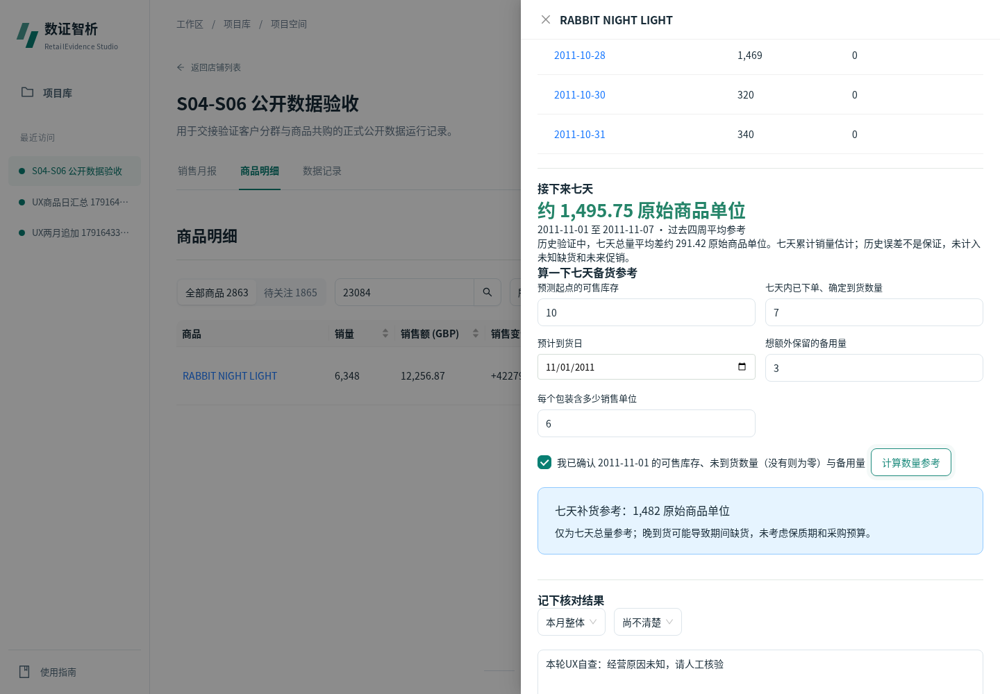
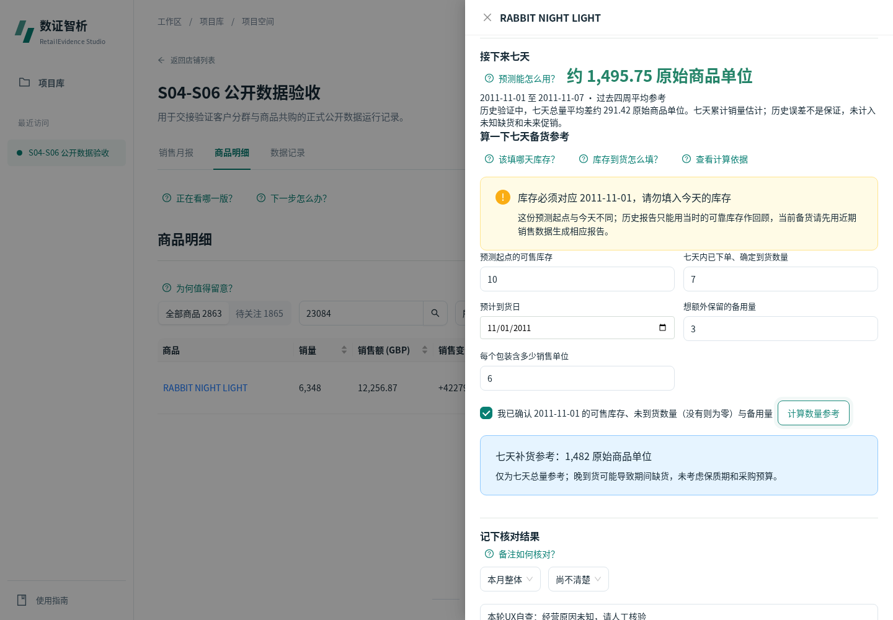
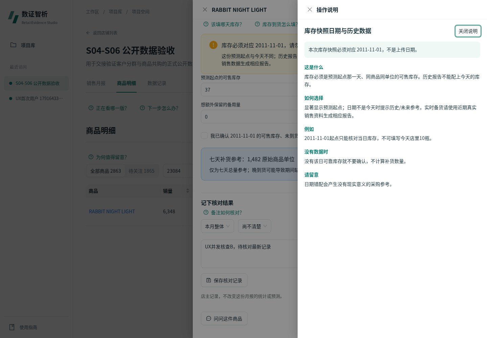

## 备注冲突（UX36）

409后现在可以读取最新而保留草稿，显示另一人已保存文字，人工核对后再次保存；真实两页409→读取→200，PASS。此行为不能仅靠文案解决。

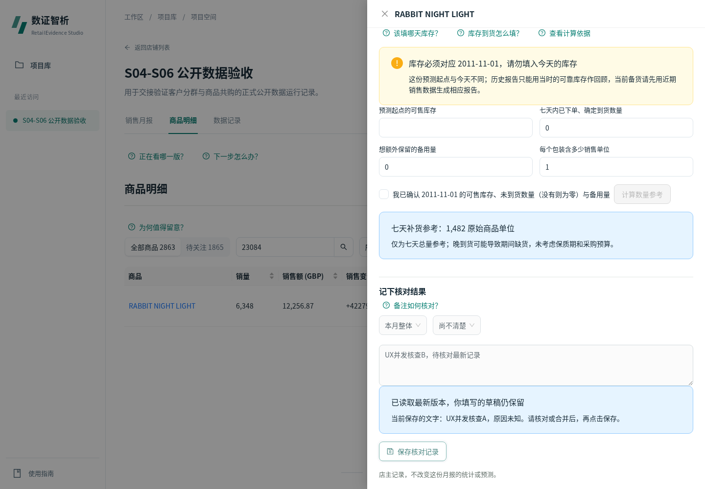

## 结果、历史与窄屏（UX27/43）

销售额不等于利润，V/M/run含义和历史刷新地址保存均可在上下文查看。768px轻提示初次超宽已修复；390px改用滚动抽屉，键盘焦点在当前帮助内循环。PASS。

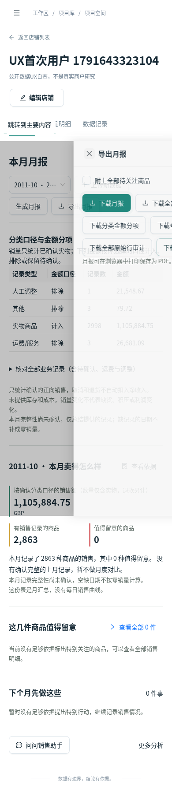
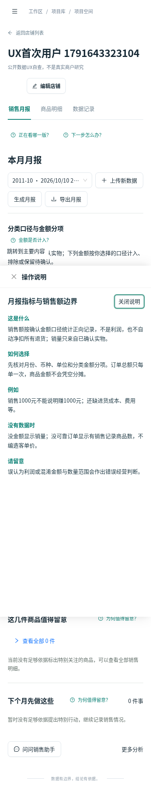
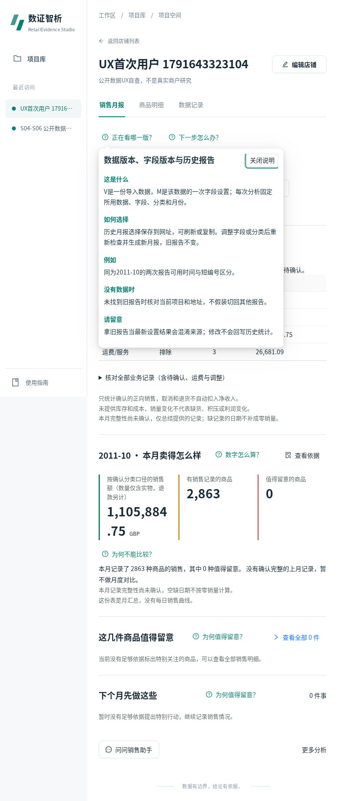

## AI与站内指南（UX37/38/46）

提供上下文例题，点击只填入，由用户再提问；真实CPU推理、澄清、数据限制与故障回退分别标明。指南按当前流程重写并复用同一帮助定义。PASS。

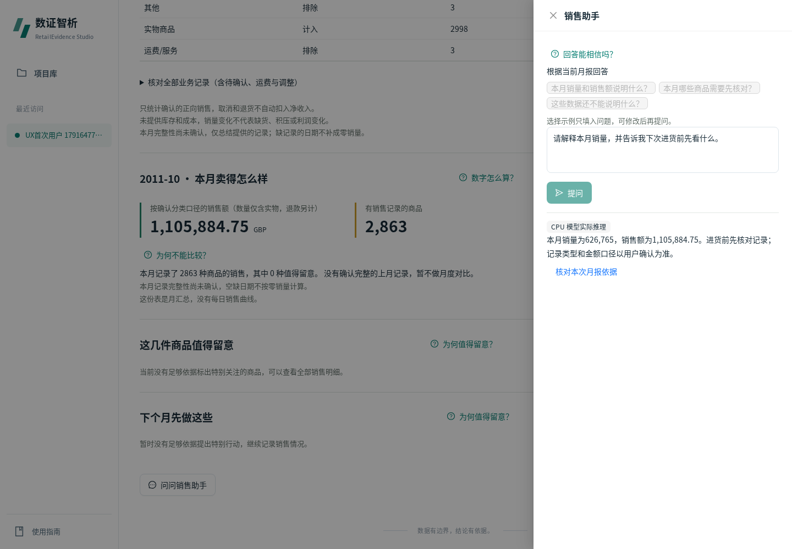
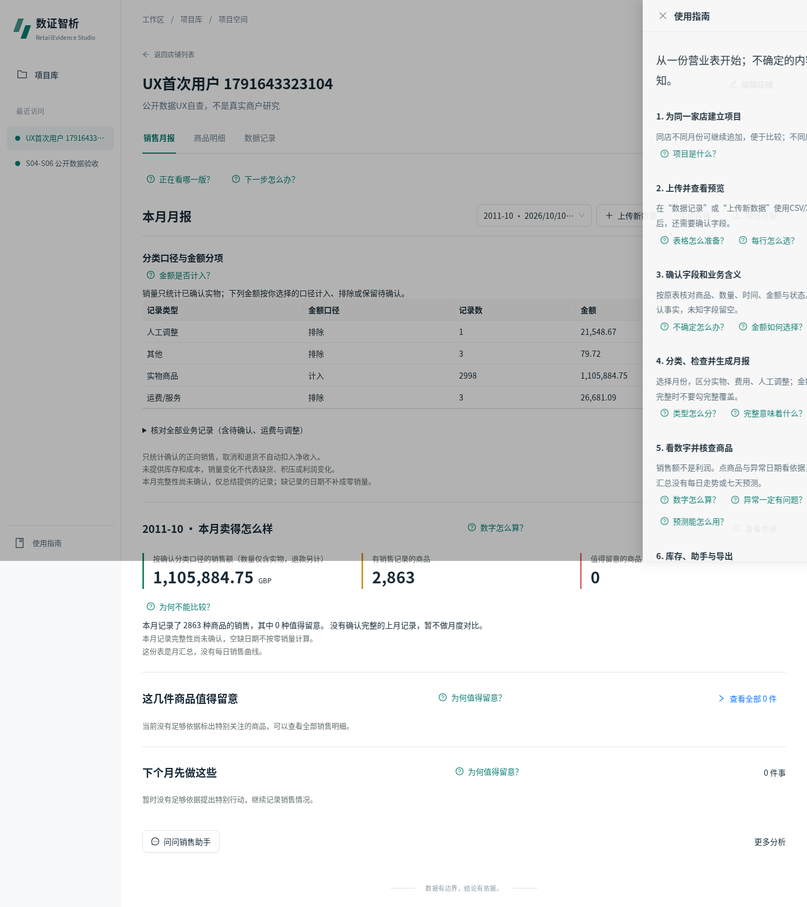

全部图片文件在Git中有SHA清单；机器验证结果和实际源码SHA见验收报告。图片本身不代替金额/状态断言。
